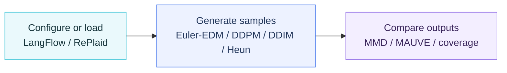

<div align="center">

<h1>
  
  Condila
</h1>

<p><strong>Continuous diffusion language models, from training to evaluation.</strong></p>
<p>LangFlow &middot; RePlaid &middot; Unified sampling &middot; Distributional evaluation</p>

<p>
  <a href="pyproject.toml"></a>
  <a href="pyproject.toml"></a>
  <a href="LICENSE"></a>
  <a href="https://github.com/hojawn/Condila"></a>
</p>

<p>
  <a href="#quickstart">Quickstart</a> &nbsp;&middot;&nbsp;
  <a href="#models-and-sampling">Models</a> &nbsp;&middot;&nbsp;
  <a href="#evaluation">Evaluation</a> &nbsp;&middot;&nbsp;
  <a href="#training">Training</a> &nbsp;&middot;&nbsp;
  <a href="#documentation">Documentation</a> &nbsp;&middot;&nbsp;
  <a href="#contributing">Contributing</a>
</p>

</div>

---

**Condila** brings continuous diffusion language models and generation metrics into
one Python library. Load a checkpoint, generate samples, and compare output
distributions through a shared API, with access to each model's native training
objectives and sampling controls.

| Build and train | Sample and compare | Evaluate and diagnose |
| :--- | :--- | :--- |
| LangFlow and RePlaid configurations, training workflows, and checkpoint loading | One sampling interface with model-specific solvers and independent sample seeds | MMD, MAUVE, GenPPL, coverage, entropy, repetition, and likelihood estimation |



## Quickstart

Requires **Python 3.10+** and **PyTorch 2.3+**. For GPU support, install a PyTorch
build compatible with your CUDA version first.

```bash
git clone https://github.com/hojawn/Condila.git
cd Condila
python -m pip install -e .
```

**Try both models without downloading a checkpoint or dataset:**

```bash
python examples/tiny_models.py
```

This example runs small, randomly initialized CPU models and reports token-level
metrics for each output set:

```text
langflow (4, 8) {'entropy': ..., 'repeat': ...}
replaid (4, 8) {'entropy': ..., 'repeat': ...}
```

Or build a small model directly:

```python
from condila.cdlm import create_model, generate
from condila.dlm_metrics import EntropyDecomposition

model = create_model(
    'langflow', vocab_size=32, hidden_size=16, cond_dim=8,
    n_blocks=1, n_heads=2, dropout=0.0, model_length=8,
)
ids = generate(model, num_samples=4, length=8, steps=2, seed=42)

metric = EntropyDecomposition()
metric.update(ids)
print(ids.shape)         # torch.Size([4, 8])
print(metric.compute())
```

<details>
<summary><strong>Optional dependencies</strong></summary>

Install extras for your workflow:

```bash
# Training and dataset processing
python -m pip install -e '.[train,data]'

# Additional evaluation and experiment tracking
python -m pip install -e '.[mauve,topics,tracking]'

# All optional runtime features
python -m pip install -e '.[all]'
```

| Extra | Features |
| :--- | :--- |
| `train` | Lightning / Hydra training and data loading |
| `data` | Dataset processing and Parquet support |
| `mauve` | MAUVE evaluation |
| `topics` | Topic coverage statistics |
| `tracking` | W&B experiment tracking |
| `test` | Testing, linting, and build tools |
| `all` | All optional runtime features |

</details>

## Models and Sampling

| Model | Namespace | Supported samplers |
| :--- | :--- | :--- |
| **LangFlow** | `condila.cdlm.langflow` | Euler-EDM |
| **RePlaid** | `condila.cdlm.replaid` | DDPM, DDIM, Heun |

```python
from condila.cdlm import from_pretrained, generate, list_models

print(list_models())  # ('langflow', 'replaid')

langflow = from_pretrained('langflow', '/path/to/langflow-checkpoint', device='cuda')
langflow_ids = generate(langflow, num_samples=8, length=1024, steps=128, seed=42)

replaid = from_pretrained('replaid', '/path/to/checkpoint-1000000', device='cuda')
replaid_ids = generate(replaid, num_samples=8, steps=128, sampler='ddpm', seed=42)
```

`create_model` constructs randomly initialized weights; `from_pretrained` loads a
checkpoint. `generate` returns a token-ID tensor of shape `[num_samples, length]`.
It temporarily switches the model to evaluation mode and restores each module's
training state afterward. With a fixed `seed`, sample i uses `seed+i` without
modifying the global random number generator state.

<details>
<summary><strong>Sampling conventions and native model interfaces</strong></summary>

The unified `steps` parameter counts solver intervals. It maps to
`num_steps=steps+1` for native LangFlow and `steps=steps` for native RePlaid.

| Model | Sampler | Denoiser calls per interval |
| :--- | :--- | :---: |
| LangFlow | `euler_edm`, `temperature=1` | 1 |
| RePlaid | `ddpm`, `ddim` | 1 |
| RePlaid | `heun` | 2 |

All samplers make one additional decoder call at the end.

```python
from condila.cdlm.langflow import LangFlow, LangFlowConfig
from condila.cdlm.replaid import RePlaid, RePlaidConfig, load_checkpoint

langflow = LangFlow(LangFlowConfig())
replaid = RePlaid(RePlaidConfig())
model, tokenizer, experiment = load_checkpoint('/path/to/checkpoint', device='cpu')
```

LangFlow supports Hugging Face model IDs, local model directories, safetensors
files, sharded weights, and Lightning checkpoints. Standalone weight files require
a sibling `config.json` or an explicit `config=` argument. Lightning checkpoints
can use their embedded architecture configuration.

A RePlaid checkpoint directory contains `experiment_config.json`,
`model.safetensors`, `ema.safetensors`, and `tokenizer/`. Use `load_checkpoint`
to retrieve the model, tokenizer, and experiment configuration together. Set
`weights='raw'` to load non-EMA weights.

</details>

## Evaluation

Compare saved outputs from multiple generators against a shared reference.
The metric interfaces also accept samples from text generators outside Condila.

```python
from condila.dlm_metrics import evaluate

report = evaluate(
    {
        'langflow': '/path/to/langflow_samples.pt',
        'replaid': '/path/to/replaid_samples.jsonl',
    },
    reference='/path/to/owt_reference.pt',
    tokenizer='gpt2', n=512, device='cuda',
)
print(report.table())
report.save('quality.json')
```

For `n` generated samples, provide at least `n` rows per generator and `2*n`
reference rows. References are split between the scoring reference and a
real-versus-real control. The tokenizer must match the generated token IDs.
`evaluate` uses GPT-2-large by default and downloads its weights if they are not cached.

Metrics follow an `update` / `compute` / `reset` lifecycle and can be combined with
`MetricCollection`. See the [metrics reference](docs/metrics.md) for the full API.

<details>
<summary><strong>MMD with precomputed features</strong></summary>

```python
import numpy as np
from condila.dlm_metrics import MMD

rng = np.random.default_rng(42)
metric = MMD(bandwidth=1.0)
metric.update_features(rng.normal(size=(64, 16)), real=True)
metric.update_features(rng.normal(size=(64, 16)) + 0.3)
print(metric.compute())
```

MMD returns U-MMD squared and its signed square root for display. The `null_sd`
field reports the standard deviation of the permutation null distribution;
it is not a confidence interval for model comparisons.

</details>

<details>
<summary><strong>Likelihood estimation</strong></summary>

Use the likelihood module with LangFlow:

```python
from condila.cdlm import from_pretrained
from condila.dlm_metrics.likelihood import LangFlowAdapter, NLLBound

model = from_pretrained('langflow', '/path/to/langflow-checkpoint', device='cuda')
bound = NLLBound(LangFlowAdapter(model), estimator='ode', n_steps=128)
# real_ids contains held-out data encoded with the model's tokenizer
bound.update(real_ids)
print(bound.compute())
```

For RePlaid held-out NELBO evaluation, use
`condila.cdlm.replaid.objective.validation_terms` or `condila-replaid-evaluate`.

</details>

## Training

Install training dependencies with `python -m pip install -e '.[train,data]'`.

```bash
# LangFlow: inspect a configuration, then launch training
condila-langflow-train --cfg job
condila-langflow-train model=langflow-owt data=openwebtext

# RePlaid: validate the configuration, then train on prepared data
condila-replaid-train --dry-run --device cpu
condila-replaid-train --data-dir /path/to/owt_gpt2 --output-dir outputs/replaid
```

LangFlow uses Hydra configuration with parameter overrides, `resume` for restoring
training state, and `init_from` for initializing weights. It retains the best
validation checkpoints, periodically saves the latest training state, and exports
Lightning and Hugging Face checkpoints at the end of training.

For distributed RePlaid training, use `torchrun -m condila.cdlm.replaid.train ...`.
Experiment logs are written to local CSV files by default. W&B tracking is available
through the `tracking` extra and training configuration.

<details>
<summary><strong>More command-line tools</strong></summary>

```bash
# Discover models and evaluate sample files
condila models
condila metrics --help
condila-metrics eval samples.pt --reference owt_ref.pt --preset owt

# Generate LangFlow samples
condila-langflow-sample --checkpoint /path/to/langflow --output samples.pt \
  --num-samples 512 --batch-size 8 --steps 128

# Prepare data, evaluate likelihood, and generate RePlaid samples
condila-replaid-prepare --help
condila-replaid-evaluate --checkpoint /path/to/checkpoint --output nelbo.json
condila-replaid-sample --checkpoint /path/to/checkpoint --output samples.jsonl
condila-replaid-score --samples samples.jsonl --output quality.json
condila-replaid-reference --help
```

Model commands also support `python -m condila.cdlm.<model>.<module>`. The LangFlow
training entry point is `condila.cdlm.langflow.cli`, and its sampling entry point
is `condila.cdlm.langflow.inference`.

</details>

## Documentation

| Resource | What you will find |
| :--- | :--- |
| [Examples](examples) | Small model demos, generation workflows, and metric examples |
| [Metrics reference](docs/metrics.md) | Metric parameters, functional interfaces, and statistical conventions |
| [Extension guide](docs/extending.md) | Registering models and composing new metrics |
| [API namespaces](#api-namespaces) | Public imports and package organization |

<details id="api-namespaces">
<summary><strong>API namespaces</strong></summary>

| Namespace | Contents |
| :--- | :--- |
| `condila.cdlm` | Model discovery, registration, construction, loading, and sampling |
| `condila.cdlm.langflow` | LangFlow configuration, model, LightningModule, and DataModule |
| `condila.cdlm.replaid` | RePlaid configuration, model, objectives, training, and evaluation |
| `condila.dlm_metrics` | Metric classes, collections, and corpus evaluation |
| `condila.dlm_metrics.functional` | Functional metric interfaces |
| `condila.dlm_metrics.likelihood` | Likelihood estimators and model adapters |

`condia.dlm_metrics` is a compatibility namespace sharing the same modules and
classes as `condila.dlm_metrics`.

</details>

## Contributing

Contributions are welcome: model integrations, samplers, metrics, examples, tests,
and documentation. [Open an issue](https://github.com/hojawn/Condila/issues) to report
a bug or discuss an idea, or [propose a change](https://github.com/hojawn/Condila/compare).
For bug reports, include your Python and PyTorch versions, a minimal reproduction,
and the expected and actual behavior.

```bash
python -m pip install -e '.[train,data,test]'
OMP_NUM_THREADS=1 MKL_NUM_THREADS=1 python -m pytest -q
python -m build
```

The default suite excludes `slow` tests that download model weights. Run
`python -m pytest -m slow` to select those integration tests.

## License

Condila is distributed under the [MIT License](LICENSE).

## Star History

If Condila is useful for your research, consider
[starring the repository](https://github.com/hojawn/Condila) to help others discover it.

<p align="center">
  <a href="https://www.star-history.com/?repos=hojawn%2FCondila&amp;type=date&amp;legend=top-left">
    <picture>
      <source media="(prefers-color-scheme: dark)" srcset="https://api.star-history.com/svg?repos=hojawn/Condila&amp;type=Date&amp;theme=dark">
      <source media="(prefers-color-scheme: light)" srcset="https://api.star-history.com/svg?repos=hojawn/Condila&amp;type=Date">
      
    </picture>
  </a>
</p>
