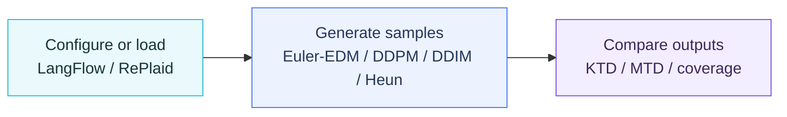
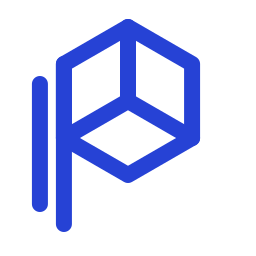
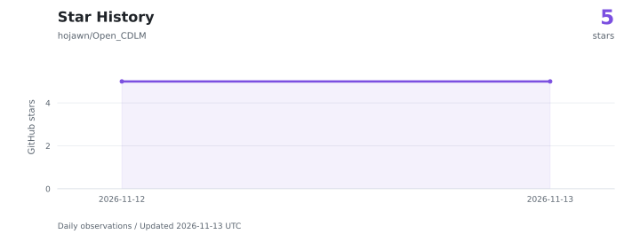

<div align="center">

<h1>Open CDLM</h1>

<p><strong>A Benchmark and Library for Continuous Diffusion Language Models</strong></p>
<p>Hao Jiang &middot; Ruixi Chen &middot; Jiayi Han &middot; Yulei Sun &middot; Yujian Chen &middot; Gen Li &middot; Brian K Chen &middot; Guang Cheng &middot; Weijian Luo &middot; Tianyang Hu</p>
<p>CDLM Baselines &middot; Unified sampling &middot; Distributional evaluation</p>

<p>
  <a href="pyproject.toml"></a>
  <a href="pyproject.toml"></a>
  <a href="LICENSE"></a>
  <a href="https://github.com/hojawn/Open_CDLM"></a>
</p>

<p>
  <!-- arXiv: replace href="#paper" with the paper URL when available. -->
  <a href="#paper"><strong>arXiv (coming soon)</strong></a>
  &nbsp;&middot;&nbsp;
  <a href="https://home.polyadiclabs.com/"><strong>Team Page</strong></a>
</p>

<p>
  <a href="#quickstart">Quickstart</a> &nbsp;&middot;&nbsp;
  <a href="#models-and-sampling">Models</a> &nbsp;&middot;&nbsp;
  <a href="#evaluation">Evaluation</a> &nbsp;&middot;&nbsp;
  <a href="#training">Training</a> &nbsp;&middot;&nbsp;
  <a href="#documentation">Documentation</a> &nbsp;&middot;&nbsp;
  <a href="#contributing">Contributing</a>
</p>

</div>

---

**Open CDLM** brings continuous diffusion language models and generation metrics into
one Python library. Load a checkpoint, generate samples, and compare output
distributions through a shared API, with access to each model's native training
objectives and sampling controls.

| Build and train | Sample and compare | Evaluate and diagnose |
| :--- | :--- | :--- |
| LangFlow and RePlaid configurations, training workflows, and checkpoint loading | One sampling interface with model-specific solvers and independent sample seeds | KTD, MTD, MAUVE, Gen PPL, coverage, entropy, repetition, and likelihood estimation |



## Quickstart

The Python package is `open_cdlm`. It requires **Python 3.10+** and **PyTorch 2.3+**.
For GPU support, install a PyTorch build compatible with your CUDA version first.

```bash
git clone https://github.com/hojawn/Open_CDLM.git
cd Open_CDLM
python -m pip install -e .
```

**Try both models without downloading a checkpoint or dataset:**

```bash
python examples/tiny_models.py
```

This example runs small, randomly initialized CPU models and reports token-level
metrics for each output set:

```text
langflow (4, 8) {'entropy': ..., 'repeat': ...}
replaid (4, 8) {'entropy': ..., 'repeat': ...}
```

Or build a small model directly:

```python
from open_cdlm.cdlm import create_model, generate
from open_cdlm.dlm_metrics import EntropyDecomposition

model = create_model(
    'langflow', vocab_size=32, hidden_size=16, cond_dim=8,
    n_blocks=1, n_heads=2, dropout=0.0, model_length=8,
)
ids = generate(model, num_samples=4, length=8, steps=2, seed=42)

metric = EntropyDecomposition()
metric.update(ids)
print(ids.shape)         # torch.Size([4, 8])
print(metric.compute())
```

<details>
<summary><strong>Optional dependencies</strong></summary>

Install extras for your workflow:

```bash
# Training and dataset processing
python -m pip install -e '.[train,data]'

# Additional evaluation and experiment tracking
python -m pip install -e '.[mauve,topics,tracking]'

# All optional runtime features
python -m pip install -e '.[all]'
```

| Extra | Features |
| :--- | :--- |
| `train` | Data preparation for native PyTorch training |
| `data` | Dataset processing and Parquet support |
| `mauve` | MAUVE evaluation |
| `topics` | Topic coverage statistics |
| `tracking` | W&B experiment tracking |
| `test` | Testing, linting, and build tools |
| `all` | All optional runtime features |

</details>

## Models and Sampling

| Model | Namespace | Supported samplers |
| :--- | :--- | :--- |
| **LangFlow** | `open_cdlm.cdlm.langflow` | Euler-EDM |
| **RePlaid** | `open_cdlm.cdlm.replaid` | DDPM, DDIM, Heun |

```python
from open_cdlm.cdlm import from_pretrained, generate, list_models

print(list_models())  # ('langflow', 'replaid')

langflow = from_pretrained('langflow', '/path/to/langflow-checkpoint', device='cuda')
langflow_ids = generate(langflow, num_samples=8, length=1024, steps=128, seed=42)

replaid = from_pretrained('replaid', '/path/to/checkpoint-1000000', device='cuda')
replaid_ids = generate(replaid, num_samples=8, steps=128, sampler='ddpm', seed=42)
```

`create_model` constructs randomly initialized weights; `from_pretrained` loads a
checkpoint. `generate` returns a token-ID tensor of shape `[num_samples, length]`.
It temporarily switches the model to evaluation mode and restores each module's
training state afterward. With a fixed `seed`, sample i uses `seed+i` without
modifying the global random number generator state.

<details>
<summary><strong>Sampling conventions and native model interfaces</strong></summary>

The unified `steps` parameter counts solver intervals. It maps to
`num_steps=steps+1` for native LangFlow and `steps=steps` for native RePlaid.

| Model | Sampler | Denoiser calls per interval |
| :--- | :--- | :---: |
| LangFlow | `euler_edm`, `temperature=1` | 1 |
| RePlaid | `ddpm`, `ddim` | 1 |
| RePlaid | `heun` | 2 |

All samplers make one additional decoder call at the end.

```python
from open_cdlm.cdlm.langflow import LangFlow, LangFlowConfig
from open_cdlm.cdlm.replaid import RePlaid, RePlaidConfig, load_checkpoint

langflow = LangFlow(LangFlowConfig())
replaid = RePlaid(RePlaidConfig())
model, tokenizer, experiment = load_checkpoint('/path/to/checkpoint', device='cpu')
```

Both models load checkpoints from the shared training loop. The directory contains
`experiment_config.json`, `model.safetensors`, `ema.safetensors`, and `tokenizer/`.
`from_pretrained` loads EMA weights by default. Pass `weights='raw'` for the
optimizer's current weights. RePlaid's `load_checkpoint` also returns the tokenizer
and experiment configuration.

LangFlow also loads Hugging Face models, sharded weights, standalone safetensors
with a model configuration, and legacy Lightning checkpoints.

</details>

## Evaluation

Compare saved outputs from multiple generators against a shared reference.
The metric interfaces also accept samples from text generators outside Open CDLM.

```python
from open_cdlm.dlm_metrics import evaluate

report = evaluate(
    {
        'langflow': '/path/to/langflow_samples.pt',
        'replaid': '/path/to/replaid_samples.jsonl',
    },
    reference='/path/to/owt_reference.pt',
    tokenizer='gpt2', n=512, device='cuda',
)
print(report.table())
report.save('quality.json')
```

For `n` generated samples, provide at least `n` rows per generator and `2*n`
reference rows. References are split between the scoring reference and a
real-versus-real control. The tokenizer must match the generated token IDs.
`evaluate` uses GPT-2-large by default and downloads its weights if they are not cached.

**Kernel Text Discrepancy (KTD)** compares corpora using projected token quantiles
and the final token state. Supply a separate corpus of real texts with
`calibration=` in Python or `--calibration` on the command line.
KTD reuses the fitted scales and bandwidth across generators and reports the
unbiased squared statistic.

```bash
open_cdlm-metrics eval generated.jsonl \
  --reference reference.jsonl --calibration calibration.jsonl \
  --metrics ktd,mtd --out quality.json
```

Metrics follow an `update` / `compute` / `reset` lifecycle and can be combined with
`MetricCollection`. See the [metrics reference](docs/metrics.md) for the full API.

<details>
<summary><strong>MTD with precomputed features</strong></summary>

```python
import numpy as np
from open_cdlm.dlm_metrics import MTD

rng = np.random.default_rng(42)
metric = MTD(bandwidth=1.0)
metric.update_features(rng.normal(size=(64, 16)), real=True)
metric.update_features(rng.normal(size=(64, 16)) + 0.3)
print(metric.compute())
```

MTD reports the signed square root in `mtd` and the squared U-statistic in `mtd2`.
With permutation repeats enabled, `null_sd` reports the standard deviation of the
permutation null distribution.

</details>

<details>
<summary><strong>Likelihood estimation</strong></summary>

Use the likelihood module with LangFlow:

```python
from open_cdlm.cdlm import from_pretrained
from open_cdlm.dlm_metrics.likelihood import LangFlowAdapter, NLLBound

model = from_pretrained('langflow', '/path/to/langflow-checkpoint', device='cuda')
bound = NLLBound(LangFlowAdapter(model), estimator='ode', n_steps=128)
# real_ids contains held-out data encoded with the model's tokenizer
bound.update(real_ids)
print(bound.compute())
```

For RePlaid held-out NELBO evaluation, use
`open_cdlm.cdlm.replaid.objective.validation_terms` or `open_cdlm-replaid-evaluate`.

</details>

## Training

LangFlow and RePlaid use the same native PyTorch loop for data loading, gradient
accumulation, distributed training, EMA, and checkpoints. Prepare the data once
and pass the same directory to both runs.

```bash
python -m pip install -e '.[train]'

open_cdlm-replaid-prepare --input '/path/to/openwebtext/*.parquet' \
  --output data/owt_gpt2 --sequence-length 1024

open_cdlm train --model langflow --data-dir data/owt_gpt2 --output-dir outputs/langflow
open_cdlm train --model replaid --data-dir data/owt_gpt2 --output-dir outputs/replaid
```

The [LangFlow preset](src/open_cdlm/cdlm/langflow/configs/owt_pytorch.yaml) and
[RePlaid preset](src/open_cdlm/cdlm/replaid/configs/owt_sc.yaml) use 1,024-token
blocks and a global batch of 512 sequences. Copy a preset and pass `--config`
to change the training recipe. `--dry-run --device cpu` checks the model and
batch configuration without opening the dataset.

```bash
torchrun --standalone --nproc-per-node=4 -m open_cdlm.cdlm.training \
  --model langflow --data-dir data/owt_gpt2 --output-dir outputs/langflow
```

Use the same launch settings and `--resume latest` to continue from the newest
checkpoint. For a partial run, set `--stop-after-steps` to keep the planned learning
rate schedule. Use `--init-from` to initialize a new run from pretrained weights.
Training and validation metrics are written to JSONL in the run directory.

LangFlow trains with denoising cross entropy and a Gumbel schedule fitting loss,
and reports held-out denoising cross entropy. RePlaid trains with its native NELBO
and reports held-out NELBO and the associated perplexity upper bound.

<details>
<summary><strong>More command-line tools</strong></summary>

```bash
# Discover models and evaluate sample files
open_cdlm models
open_cdlm metrics --help
open_cdlm-metrics eval samples.pt --reference owt_ref.pt --preset owt

# Generate LangFlow samples
open_cdlm-langflow-sample --checkpoint /path/to/langflow --output samples.pt \
  --num-samples 512 --batch-size 8 --steps 128

# Prepare data, evaluate likelihood, and generate RePlaid samples
open_cdlm-replaid-prepare --help
open_cdlm-replaid-evaluate --checkpoint /path/to/checkpoint --output nelbo.json
open_cdlm-replaid-sample --checkpoint /path/to/checkpoint --output samples.jsonl
open_cdlm-replaid-score --samples samples.jsonl --output quality.json
open_cdlm-replaid-reference --help
```

The `open_cdlm-langflow-train` and `open_cdlm-replaid-train` commands select their
respective models in the shared trainer. Existing Lightning and Hydra runs are
available via `python -m open_cdlm.cdlm.langflow.legacy_cli` with the
`legacy-langflow` extra.

</details>

## Documentation

| Resource | What you will find |
| :--- | :--- |
| [Examples](examples) | Small model demos, generation workflows, and metric examples |
| [Metrics reference](docs/metrics.md) | Metric parameters, functional interfaces, and statistical conventions |
| [Extension guide](docs/extending.md) | Registering models and composing new metrics |
| [API namespaces](#api-namespaces) | Public imports and package organization |

<details id="api-namespaces">
<summary><strong>API namespaces</strong></summary>

| Namespace | Contents |
| :--- | :--- |
| `open_cdlm.cdlm` | Model discovery, registration, construction, loading, and sampling |
| `open_cdlm.cdlm.training` | Shared training loop and experiment CLI |
| `open_cdlm.cdlm.langflow` | LangFlow configuration, model, and checkpoint loading |
| `open_cdlm.cdlm.replaid` | RePlaid configuration, model, objectives, training, and evaluation |
| `open_cdlm.dlm_metrics` | Metric classes, collections, and corpus evaluation |
| `open_cdlm.dlm_metrics.functional` | Functional metric interfaces |
| `open_cdlm.dlm_metrics.likelihood` | Likelihood estimators and model adapters |

</details>

## Paper

**Open CDLM: A Benchmark and Library for Continuous Diffusion Language Models**

Hao Jiang<sup>1,2,&#42;</sup>, Ruixi Chen<sup>1,2,&#42;</sup>,
Jiayi Han<sup>1,2</sup>, Yulei Sun<sup>1,2</sup>, Yujian Chen<sup>1,3</sup>,
Gen Li<sup>4</sup>, Brian K Chen<sup>5</sup>, Guang Cheng<sup>6</sup>,
Weijian Luo<sup>7</sup>, and Tianyang Hu<sup>1,2</sup>.

Manuscript, 2026. The arXiv link will be added when available.

<details>
<summary><strong>Affiliations and correspondence</strong></summary>

1. Polyadic Research Group
2. SAGA Lab, The Chinese University of Hong Kong, Shenzhen
3. School of Computer Science, Peking University
4. The Chinese University of Hong Kong
5. National University of Singapore
6. University of California, Los Angeles
7. Dots Studio, Xiaohongshu

<sup>&#42;</sup> These authors contributed equally.

[Weijian Luo](mailto:pkulwj1994@icloud.com) and
[Tianyang Hu](mailto:hutianyang@cuhk.edu.cn) are the corresponding authors.

</details>

<details>
<summary><strong>Citation (BibTeX)</strong></summary>

```bibtex
@misc{jiang2026opencdlm,
  title  = {{Open CDLM}: A Benchmark and Library for Continuous Diffusion Language Models},
  author = {Jiang, Hao and Chen, Ruixi and Han, Jiayi and Sun, Yulei and Chen, Yujian
            and Li, Gen and Chen, Brian K and Cheng, Guang and Luo, Weijian and Hu, Tianyang},
  year   = {2026},
  note   = {Manuscript}
}
```

</details>

## Research Team

<p>
  <a href="https://home.polyadiclabs.com/">
    
    <strong>Polyadic Research Group</strong>
  </a>
</p>

We study continuous diffusion language models, parallel inference and reasoning,
and efficient machine intelligence.

## Contributing

Contributions are welcome: model integrations, samplers, metrics, examples, tests,
and documentation. [Open an issue](https://github.com/hojawn/Open_CDLM/issues) to report
a bug or discuss an idea, or [propose a change](https://github.com/hojawn/Open_CDLM/compare).
For bug reports, include your Python and PyTorch versions, a minimal reproduction,
and the expected and actual behavior.

```bash
python -m pip install -e '.[train,data,test]'
OMP_NUM_THREADS=1 MKL_NUM_THREADS=1 python -m pytest -q
python -m build
```

The default suite excludes `slow` tests that download model weights. Run
`python -m pytest -m slow` to select those integration tests.

## License

Open CDLM is distributed under the [MIT License](LICENSE).

## Star History

If Open CDLM is useful for your research, consider
[starring the repository](https://github.com/hojawn/Open_CDLM) to help others discover it.

<p align="center">
  <a href="https://github.com/hojawn/Open_CDLM/stargazers">
    <picture>
      <source media="(prefers-color-scheme: dark)" srcset="docs/assets/star-history-dark.svg">
      <source media="(prefers-color-scheme: light)" srcset="docs/assets/star-history.svg">
      
    </picture>
  </a>
</p>

[Daily snapshots](docs/assets/star-history.json) are recorded by
[GitHub Actions](.github/workflows/star-history.yml), starting with the first successful update.
